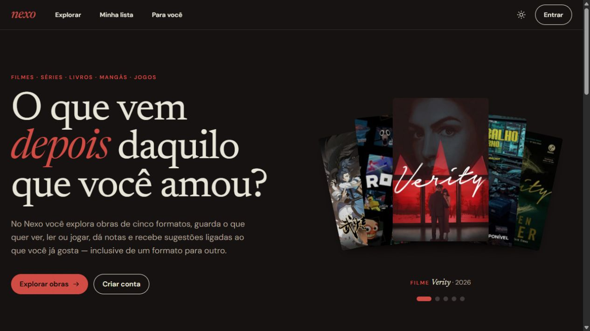

<div align="center">

# ML Lab

**Machine learning experiments. Working applications.**

A personal collection of projects in machine learning and AI engineering, connecting data, models, and the people who use them.

[](https://github.com/withxlari/ML-Lab/actions/workflows/nexo-quality.yml)


[Projects](#projects) · [Meet Nexo](#nexo) · [How recommendations work](#how-recommendations-work) · [Run locally](#run-locally)

</div>

---

## Projects

| Project | What it does | Status |
| :--- | :--- | :--- |
| **[Nexo](projects/nexo)** | Discover movies, TV series, books, manga, and games through personal recommendations. | Live · In development |

Projects live under `projects/`, with their own source code, dependencies, tests, and setup instructions.

## Nexo

### Your next favorite might be in a different format.

Nexo brings **movies, TV series, books, manga, and games** into one place. Keep track of what you have explored, share selected favorites and reviews, and find something new based on what you enjoy.

The idea is simple: a favorite film can lead to a book, a manga can point to a game, and a review can reveal more about your taste than a genre label alone.

**[Open Nexo →](https://nexo-aiproject.vercel.app)** &nbsp;·&nbsp; [Explore the source](projects/nexo) &nbsp;·&nbsp; [Project guide](projects/nexo/README.md)

[](https://nexo-aiproject.vercel.app)

### What you can do

- **Explore five formats.** Search connected catalogs and browse selections that refresh over time, including a dated Brazilian book selection.
- **Build a personal library.** Save works, track progress, mark favorites, give ratings, and write reviews. Recording something as completed does not automatically mean you liked it.
- **Describe your taste.** Set preferred genres, themes, and things you would rather avoid. Likes, dislikes, and written preferences contribute to recommendations.
- **Understand a suggestion.** See which works or preferences contributed to it, then give feedback to adjust future results.
- **Make a profile your own.** Choose up to five favorites per format, publish selected reviews and ratings, and control the visibility of statistics and social connections.
- **Find other people.** Search public profiles, follow readers, viewers, and players, and discover profiles with tastes in common.

### How recommendations work

Nexo currently uses a **content-based recommender** with multilingual MiniLM embeddings. It compares the meaning of work descriptions and preference text, rather than relying only on exact keywords.

1. **Prepare the catalog.** Normalize genres, validate metadata, and identify works across providers to reduce duplicates.
2. **Represent works and tastes.** Generate embeddings with FastEmbed and ONNX Runtime. Ratings, favorites, Top 5 choices, written preferences, and feedback provide positive or negative signals.
3. **Rank candidates.** Combine semantic similarity with those signals, apply supported preference filters, and exclude works already in the user's library.
4. **Explain and refine.** Show the connections behind each suggestion. New feedback changes the user's ranking inputs; it does not retrain the underlying embedding model.

The model runs in the backend. Private preference text is not sent to an external generative AI service. Signal weights are currently heuristic, and recommendation quality is still being evaluated with real use. Earlier genre and text baselines remain in the project for comparison and learning.

### Technology

| Layer | Tools |
| :--- | :--- |
| Frontend | React · TypeScript · Vite |
| Backend | Python · FastAPI |
| Recommendations | FastEmbed · ONNX Runtime · Multilingual MiniLM |
| Database, accounts, and storage | Supabase · PostgreSQL · Auth · Storage |
| Hosting | Vercel for the frontend and API |
| Quality checks | Pytest · Vitest · Ruff · mypy · ESLint · Prettier · GitHub Actions |

**Catalog sources:** TMDB for movies and TV series; Google Books and Open Library for books; BookInfo for the Brazilian book selection; Kitsu for manga; IGDB for games.

### Privacy and project status

Browsing is public. Saving, rating, reviewing, and following require an account. Personal libraries and taste settings remain private; public profiles and their visible sections are controlled by the user. Database access uses ownership policies through PostgreSQL row-level security.

Nexo is an **early version under active development**. Features, visual details, and recommendation behavior will continue to change. A live deployment is not a claim of production readiness.

## Run locally

The setup below targets **Windows / PowerShell**. Install Git, Node.js 24, Python 3.12, and uv first.

```powershell
git clone https://github.com/withxlari/ML-Lab.git
cd ML-Lab/projects/nexo
.\scripts\setup.ps1
```

Fill in `backend/.env` and `frontend/.env` using the supplied `.env.example` files. API credentials belong in the backend; only public configuration belongs in the frontend.

Prepare the recommendation model once:

```powershell
Push-Location backend
uv run python -m app.semantic
Pop-Location
```

Start the API and frontend in separate terminals, both from `projects/nexo`:

```powershell
# Terminal 1 — API
.\scripts\backend.ps1 dev
```

```powershell
# Terminal 2 — frontend
npm.cmd --prefix frontend run dev
```

Open **http://127.0.0.1:5173**. The API runs at **http://127.0.0.1:8000**. A separate Supabase project also needs the database setup described in the [project guide](projects/nexo/README.md).

Run the project checks with:

```powershell
.\scripts\check.ps1
```

---

**Repository hygiene:** credentials, private data, downloaded models, caches, local environments, and build output stay outside Git. Each project keeps its dependency lockfiles and tests alongside the code.
