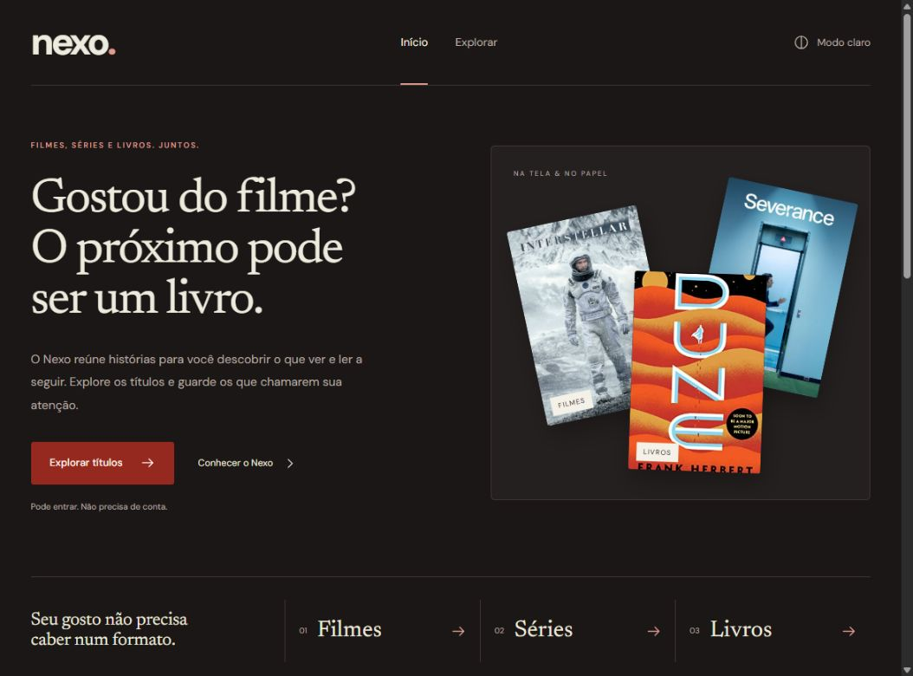

# Nexo

A media discovery project connecting movies, series and books through personal preferences.

**Status:** Phase 0 complete as a local foundation, privately versioned in ML-lab and verified by GitHub Actions. Database setup follows the agreed data-model/API learning step; catalog integration, authentication, server persistence and recommendation models are not implemented.

## What works today

- Public Portuguese home plus separate exploration and local-library pages, using the Cotton, Cherry Red, Maroon and Noir Black palette.
- Persistent light/dark themes, self-hosted DM Sans and Newsreader fonts, media-type filters, search, native detail dialogs and a browser-local saved list.
- React and TypeScript with strict type checking, Vite and Tailwind CSS.
- FastAPI application with validated environment configuration and OpenAPI documentation.
- Frontend-to-API health request with loading, error, timeout and retry behavior.
- Frontend and backend tests, linting, formatting and type checking.
- Locked dependencies and GitHub Actions, with both frontend and backend jobs verified successfully on Ubuntu.

## Local development on Windows



Prerequisites: Node.js 24, npm, Git and uv. The setup script downloads Python 3.12 into the ignored `.runtime/python` directory and creates `backend/.venv`. It does not replace your system Python.

When cloning the ML-lab repository, first enter projects/nexo. From the Nexo project root:

```powershell
.\scripts\setup.ps1
```

Start the API in one terminal:

```powershell
.\scripts\backend.ps1 dev
```

Start the interface in another terminal:

```powershell
cd frontend
npm.cmd run dev
```

Open [Nexo home](http://127.0.0.1:5173), [Explore](http://127.0.0.1:5173/explore), [local library](http://127.0.0.1:5173/library) or [API documentation](http://127.0.0.1:8000/docs). Development-only API diagnostics are at /dev/status.

No credentials are needed for the current foundation. Optional configuration examples are in `frontend/.env.example` and `backend/.env.example`. Copy them to `.env` in their respective directories when needed. Never commit real credentials.

Run all local checks:

```powershell
.\scripts\check.ps1
```

The frontend proxy forwards `/health` to the API on port 8000. Production hosting will need an API URL or reverse proxy; development settings are not a deployment configuration.

## Structure

```text
frontend/       UI, API client and component tests
backend/        API routes, validated settings and backend tests
ml/             Experiment scope; models will be added in a later phase
docs/           Product specification, architecture and learning guide
scripts/        Windows setup, development and validation helpers
.github/        Continuous integration definition
```

## Planned architecture

React → FastAPI → PostgreSQL hosted by Supabase. Supabase Auth will manage identity; business operations will pass through FastAPI. Python pipelines will prepare authorized metadata and generate embeddings outside request handling. The initial recommender will compare a popularity baseline with content-based recommendations.

See [current API](docs/api.md), [interface and image credits](docs/interface.md), [architecture](docs/architecture.md), [development guide in Portuguese](docs/development.md), [Phase 0 status](docs/phase-0.md) and [product specification](docs/product-specification.md).

## Next steps and limits

1. Design the MediaItem API contract and implement the first in-memory catalog route.
2. Design the schema and migrations with SQLAlchemy/Alembic, then configure PostgreSQL/Supabase.
3. Integrate TMDB and Open Library after reviewing current usage terms.
4. Add authentication, interactions and personal libraries.
5. Implement and evaluate real recommendation baselines.

The local health endpoint reports API liveness only. It does not verify database readiness. No ML metrics or personalization results are claimed. MovieLens experiments will not establish cross-media performance by themselves.

Private GitHub workspace: [ML-lab / Nexo](https://github.com/withxlari/ml-lab/tree/main/projects/nexo). See [GitHub organization and publishing](docs/github.md) and the [Phase 0 evaluation guide in Portuguese](docs/avaliacao-fase-0.md). No public website deployment is configured. A code license has not yet been selected.
