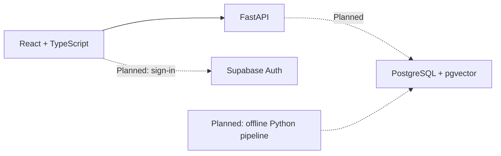

# Architecture

## Initial decision

Nexo uses one repository and a modular Python API. Separate services are unnecessary at this stage. The UI and the API have separate dependencies and can be deployed independently later.

Solid arrows are implemented; dashed arrows are planned.

## Current request path

`ApiStatus` → TanStack Query → `services/api.ts` → Vite's development proxy → `GET /health`.

The API client checks HTTP status and the JSON contract, aborts requests after eight seconds and accepts query cancellation. TanStack Query owns loading, caching and refetch behavior. The diagnostic panel is visible only in development.

`create_app` accepts validated settings, making application instances independent in tests. The health response uses a Pydantic schema. CORS permits only the configured local origins and GET requests; expand it with tests when mutations and authentication are introduced.

## Runtime decisions

- Node 24 is the development baseline.
- Python 3.12 is isolated from the Windows Python aliases. Future ML dependencies require their own compatibility validation.
- TypeScript 6 is used because the installed TypeScript ESLint parser does not support the generator's TypeScript 7.
- `package-lock.json` and `uv.lock` record resolved dependencies.
- No API keys, paid AI service, model download or database is required to start Phase 0.

## Next boundaries

Business endpoints will use `/api/v1`. Add service, repository, schema and integration modules as features need them. Do not add placeholder abstractions.

SQLAlchemy and Alembic will manage persistence. Use a dedicated database schema/access strategy that prevents business tables from being exposed unintentionally through Supabase's Data API. Enable RLS on exposed tables and test ownership. Administrative credentials remain server-side.

The runtime API will load previously generated ML artifacts. Training and embedding generation will live outside HTTP request handling. Similarity is not a probability of user satisfaction.

## Sources checked during setup

- [Vite guide](https://vite.dev/guide/)
- [Tailwind Vite integration](https://tailwindcss.com/docs/installation/using-vite)
- [FastAPI first steps](https://fastapi.tiangolo.com/tutorial/first-steps/)
- [uv projects and lockfiles](https://docs.astral.sh/uv/guides/projects/)
- [Vitest guide](https://vitest.dev/guide/)
- [Supabase API keys](https://supabase.com/docs/guides/getting-started/api-keys)

## Public and application navigation

React Router separates the public landing page (/) from exploration (/explore) and the local saved list (/library). Theme and list state are shared above the route components. API diagnostics are restricted to the development-only /dev/status route. The static editorial sample is not fetched from a catalog API and is not a model recommendation. See interface.md for details.
